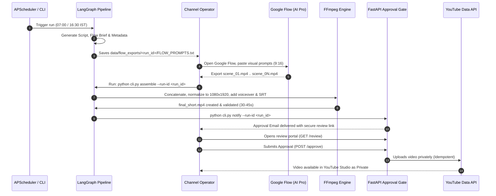

# Operator Runbook: Daily YouTube Shorts Production

This runbook outlines the daily operating workflow for creating two daily AI Engineering YouTube Shorts using Google Flow, FFmpeg, email approval, and YouTube Data API v3.

---

## ⏰ Daily Production Schedule

| Slot | Scheduled Trigger Time (IST) | Target Video Topic Domain |
| :--- | :--- | :--- |
| **Morning** | **07:00 AM IST** | Core AI Systems, LLM Architecture, Model Context Protocol (MCP), Inference Optimization |
| **Evening** | **04:30 PM IST** (16:30) | Advanced RAG, AI Agents, Vector DBs, LLM Evaluation, AI Security & Guardrails |

---

## 🔄 Daily Workflow Walkthrough



---

## 📝 Step-by-Step Operating Instructions

### Step 1: Inspect the Generated Flow Brief
At 07:00 AM or 16:30 PM (or upon manual execution with `python cli.py generate --slot morning`), open:
```
data/flow_exports/<run_id>/FLOW_PROMPTS.txt
```
This file contains:
- Selected topic and hook.
- Scene-by-scene timing (e.g. 5–8s per scene).
- Exact visual generation prompts optimized for vertical 9:16 rendering in Google Flow.
- Spoken narration and on-screen overlay text.

### Step 2: Generate Video Clips in Google Flow
1. Navigate to **Google Flow** under your **Google AI Pro** account.
2. For each scene in `FLOW_PROMPTS.txt`:
   - Select **9:16 Vertical Video** mode.
   - Paste the scene's `FLOW VISUAL PROMPT`.
   - Set the duration matching the scene requirement.
   - Generate and export the video clip.
3. Save the exported clips into the run folder:
   ```
   data/flow_exports/<run_id>/scene_01.mp4
   data/flow_exports/<run_id>/scene_02.mp4
   data/flow_exports/<run_id>/scene_03.mp4
   data/flow_exports/<run_id>/scene_04.mp4
   data/flow_exports/<run_id>/scene_05.mp4
   ```
   *(Optional: If you wish to use your own recorded voice rather than the automated Edge-TTS neural voice, save your voiceover as `data/flow_exports/<run_id>/voiceover.mp3`).*

### Step 3: Assemble & Validate Video
Run the assembly command locally:
```powershell
python cli.py assemble --run-id <run_id>
```
*Or using Docker:*
```powershell
docker compose run --rm approval-service assemble --run-id <run_id>
```
The assembly engine will:
- Confirm all scene clips exist and are non-empty.
- Generate high-quality neural voiceover with Edge-TTS (`en-US-ChristopherNeural`) and subtitle timing if no manual audio was provided.
- Concatenate clips in exact numerical order.
- Scale and pad to **1080x1920 (9:16 portrait)**, 30 fps, H.264 video with AAC audio.
- Validate that final duration is strictly within 30–45 seconds.
- Compute SHA-256 checksum and save to `data/final/<run_id>/final_short.sha256`.

### Step 4: Dispatch Review Notification
Send the review notification email:
```powershell
python cli.py notify --run-id <run_id>
```
*Or using Docker:*
```powershell
docker compose run --rm approval-service notify --run-id <run_id>
```
Make sure the approval web service is running (locally via `python cli.py serve` or in Docker via `docker compose up -d`).

### Step 5: Review & Authorize
1. Open the approval email on your desktop or browser.
2. Click **Review & Authorize Video**.
3. Inspect the video preview, check script and hashtags on the web portal.
4. Click **Approve & Upload Privately**:
   - The token is consumed immediately (preventing replay attacks).
   - The video is uploaded to your YouTube channel as **Private**.
   - The YouTube Video ID is recorded in `data/upload_ledger.json`.
5. *(Optional)*: If you reject the video, click **Reject & Cancel Upload**. The run status is marked `rejected` and no upload will occur.

### Step 6: YouTube Studio Final Check
Log into [studio.youtube.com](https://studio.youtube.com):
- Locate the newly uploaded private Short under **Content > Shorts**.
- Review title, tags, description, and synthetic media disclosure.
- When ready, schedule public release or publish immediately.

---

## 🔧 Google Cloud & YouTube OAuth Setup

To enable real uploads to your YouTube channel:

1. Go to [Google Cloud Console](https://console.cloud.google.com).
2. Create a new project (e.g. `youtube-shorts-automation`).
3. Enable **YouTube Data API v3** under **APIs & Services > Library**.
4. Configure the **OAuth Consent Screen**:
   - User Type: **External**.
   - App Name: `AI Engineering Shorts Producer`.
   - Add Test User: Your channel owner email address.
   - Add Scope: `https://www.googleapis.com/auth/youtube.upload`.
5. Go to **Credentials > Create Credentials > OAuth client ID**:
   - Application type: **Desktop app**.
   - Download the JSON file and save it in your project root as `client_secret.json`.
6. On the first upload, a browser window will open asking you to log into your YouTube channel and authorize upload access. A `token.json` file will automatically be saved and refreshed for all future uploads.

---

## 🚨 Troubleshooting & FAQ

### Q1: Asset intake fails with "Missing expected clip for scene X"?
- **Cause**: Clips were exported with non-standard names.
- **Fix**: Ensure exported files follow `scene_01.mp4`, `scene_02.mp4` naming convention inside `data/flow_exports/<run_id>/`.

### Q2: Approval link reports "This approval token has expired"?
- **Cause**: Tokens expire after 24 hours.
- **Fix**: Generate a new review token by running:
  ```powershell
  python cli.py notify --run-id <run_id>
  ```

### Q3: Video assembly duration error?
- **Cause**: Total scene clips duration was shorter than 30s or longer than 45s.
- **Fix**: Check `FLOW_PROMPTS.txt` for recommended durations and re-export any clip that was truncated.
