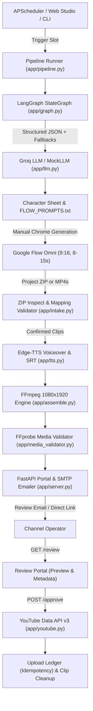

# YouTube Shorts Studio & Automation System

A human-in-the-loop **YouTube Shorts Studio & Production Pipeline** built with **FastAPI**, **LangGraph**, **Groq**, **Edge-TTS**, **FFmpeg**, **APScheduler**, and **YouTube Data API v3**. It automates topic discovery, scriptwriting, consistent character sheets, Google Flow Omni scene prompts, safe project ZIP import & clip mapping, 9:16 vertical video assembly, token-gated human review, and idempotent YouTube publishing across any niche and five supported languages.

---

## Key Features

- **Multi-Niche & Multi-Language Studio**:
  - Configurable for any content niche (default preset: `AI Engineering Shorts Studio`), audience tone, call-to-action, and YouTube category directly from the Web UI or `.env`.
  - Native script, voiceover, and SEO metadata support for **English**, **Telugu (`తెలుగు`)**, **Hindi (`हिन्दी`)**, **Tamil (`தமிழ்`)**, and **Malayalam (`മലയാളം`)**, with automatic locale-matched Edge-TTS voice resolution.
- **Resilient LangGraph + Groq Content Pipeline**:
  - 6-node LangGraph `StateGraph` (`select_topic` → `research_topic` → `draft_script` → `generate_metadata` → `create_flow_prompts` → `validate_package`) with automatic validation retries (up to `MAX_RETRIES`).
  - Persistent `topic_history.json` prevents duplicate topics across runs.
  - Configurable `llm_temperature` (`0.0–1.5`, default `0.9`), optional **Style & Description Memory** (`prompt_style_examples` + UI presets), and automatic `MockLLM` fallback for offline dry runs (`--mock` or unconfigured API key).
  - Structured output resilience (`json_mode` first, `<think>`/code-fence/XML `<parameter=...>` JSON recovery, Qwen output-token capping, and fallback model chain across `llama-3.3-70b-versatile` and `llama-3.1-8b-instant`).
- **Google Flow Omni Prompts & Safe Project ZIP Import**:
  - Generates 1–3 recurring `CharacterProfile` definitions and 3–8 sequential **8–15s** 9:16 vertical prompts in `data/flow_exports/<run_id>/FLOW_PROMPTS.txt` for **Google Flow (Google AI Pro)** in your standard Chrome browser (no brittle browser automation or credential scraping).
  - **Inspect → Preview → Confirm → Retry ZIP Workflow**:
    - Pre-extraction security and integrity checks (`zipfile.testzip()` CRC verification, path traversal / drive-letter / null-byte / POSIX symlink rejection, `__MACOSX` and dotfile filtering, size and member limits).
    - `ffprobe` validation on every extracted `.mp4`, deterministic sorting, duplicate clip detection (by scene slot or SHA-256), corrupted/missing clip reporting, interactive mapping overrides, partial staging, non-destructive preservation of original `.zip` + `raw/` clips, and one-click retry without re-uploading.
    - Also supports parallel multi-file XHR uploads (`scene_01.mp4..`, `.zip`, or custom `voiceover.mp3`).
- **Automated FFmpeg 9:16 Assembly & Audio Modes**:
  - Normalizes heterogeneous scene clips to **1080×1920 (9:16 portrait)**, 30 FPS, H.264 (`yuv420p`), AAC 192k (`+faststart`) with SHA-256 checksum (`final_short.sha256`).
  - Three configurable audio modes: `ai_voiceover` (default neural `Edge-TTS` + WordBoundary `captions.srt`), `ai_plus_clip_audio` (voiceover mixed with 20% original clip audio), and `clip_audio_only` (falls back to AI voiceover if clips lack audio). Automatically pads video (`tpad=stop_mode=clone`) if voiceover exceeds clip length within bounds, and preserves custom uploaded `voiceover.mp3`.
- **Sage & Cream Web Studio Dashboard**:
  - Responsive light/dark UI (`/` and `/dashboard`) with 6 workspaces: **Overview**, **Videos & Pipeline**, **Publishing Ledger**, **Schedule**, **Activity & Logs** (live redacted log viewer), and **Settings & Health**.
  - Inline metadata, narration, category, visibility, and AI-disclosure editor, plus byte-range video streaming (`/video/{run_id}`).
- **Token-Gated Review & Idempotent YouTube Publishing**:
  - Single-use 32-byte URL-safe tokens stored as SHA-256 hashes with configurable expiration (`24h` default).
  - Anti-scanner design: `GET /review/{run_id}` only renders the preview portal; publishing requires an explicit interactive `POST /approve/{run_id}` (or `POST /reject/{run_id}`), returning `409 Conflict` on replay and `410 Gone` on expiry.
  - Supports **Private** (default), **Unlisted**, or **Public** visibility, `containsSyntheticMedia` disclosure, `upload_ledger.json` duplicate-upload idempotency, and automatic post-publish cleanup of intermediate `scene_xx.mp4` clips while retaining `final_short.mp4`, `captions.srt`, and preserved ZIP imports.

---

## Architecture Overview



---

## Project Structure

```text
youtube-automation/
├── cli.py                      # Unified CLI (generate, assemble, notify, serve, youtube-auth, schedule, status, test-tts)
├── modal_app.py                # Modal serverless web app, persistent volume sync, and cron functions
├── Dockerfile                  # Python 3.11 + FFmpeg container image honoring $PORT
├── docker-compose.yml          # Multi-service stack (approval-service + scheduler-service)
├── render.yaml                 # Render Blueprint configuration
├── requirements.txt            # Python dependencies
├── pytest.ini                  # Pytest configuration
├── .env.example                # Environment variable template
├── OPERATIONAL_RUNBOOK.md      # Daily operator step-by-step runbook & OAuth guide
├── app/
│   ├── config.py               # Pydantic settings, language profiles, and TTS locale resolver
│   ├── models.py               # Domain schemas (ProductionPackage, StudioConfig, ZipImportRecord, ApprovalRecord, UploadRecord)
│   ├── llm.py                  # ChatGroq factory, MockLLM, JSON-mode/XML recovery, fallback models
│   ├── graph.py                # LangGraph workflow nodes & validation retry routing
│   ├── pipeline.py             # End-to-end content generation orchestration & FLOW_PROMPTS.txt writer
│   ├── intake.py               # ZIP security validation, FFprobe inspection, scene mapping & asset intake
│   ├── tts.py                  # Edge-TTS speech & WordBoundary SRT subtitle generator
│   ├── assemble.py             # FFmpeg 1080x1920 normalization, audio mixing, tpad, and SHA-256 hashing
│   ├── media_validator.py      # FFprobe validation for resolution, streams, and duration bounds
│   ├── storage.py              # Thread-safe JSON persistence (packages, history, approvals, ledger, settings, ZIP manifests)
│   ├── emailer.py              # Single-use token generation & HTML/text SMTP approval notifications
│   ├── youtube.py              # YouTube Data API v3 OAuth loader, resumable upload, idempotency, clip cleanup
│   ├── scheduler.py            # APScheduler daily morning/evening cron configuration
│   ├── server.py               # FastAPI web dashboard, ZIP import/upload APIs, video streaming, review gate
│   ├── ui_helpers.py           # Dashboard health checks, plain-English error explanations, timeline & ledger builders
│   ├── logging_config.py       # Console + file logging with automatic secret redaction
│   ├── templates/              # Jinja2 templates (dashboard.html, review.html, decision.html)
│   └── static/                 # Frontend assets (app.js, styles.css, favicon.svg)
├── tests/                      # Offline automated test suite (37 tests)
└── data/                       # Local runtime storage (packages/, flow_exports/, final/, *.json)
```

---

## Prerequisites

1. **Python 3.11+** (Windows, macOS, or Linux)
2. **FFmpeg & FFprobe** installed and available on system `PATH` (e.g., `winget install Gyan.FFmpeg` on Windows or `apt-get install ffmpeg` on Debian/Ubuntu)
3. **Groq API Key** from [console.groq.com](https://console.groq.com) *(optional for offline `--mock` dry runs)*
4. **Google Flow (Google AI Pro)** via your regular Chrome browser for rendering 9:16 scene clips
5. **Google Cloud Project with YouTube Data API v3** *(optional; omit credentials to run in safe mock upload mode)*
6. **SMTP Credentials** *(optional; omit to log review links in dry-run mode and open them from the Web Studio)*

---

## Quick Start (Local)

1. **Create and activate a virtual environment**:
   ```powershell
   python -m venv .venv
   .venv\Scripts\Activate.ps1
   ```
   *(On macOS/Linux: `source .venv/bin/activate`)*

2. **Install dependencies**:
   ```powershell
   pip install -r requirements.txt
   ```

3. **Configure environment variables**:
   ```powershell
   Copy-Item .env.example .env
   ```
   Edit `.env` with your `GROQ_API_KEY`, `APPROVAL_SECRET_KEY`, and optional SMTP/YouTube settings.

4. **Verify installation with the offline test suite**:
   ```powershell
   python -m pytest -v
   ```

5. **Launch the Web Studio & Review Portal**:
   ```powershell
   python cli.py serve
   ```
   Open [http://127.0.0.1:8000](http://127.0.0.1:8000) in your browser.

6. *(Optional)* **Authorize YouTube OAuth locally**:
   Place your Desktop App OAuth JSON at `client_secret.json` and run:
   ```powershell
   python cli.py youtube-auth
   ```
   This saves `token.json` for local, Docker, Render, or Modal uploads.

---

## Studio Workflow

1. **Generate a Short Brief**: In the **Overview** tab (or via `python cli.py generate`), pick a niche, language, optional topic, and optional style memory examples. The pipeline produces `data/packages/<run_id>.json` and `data/flow_exports/<run_id>/FLOW_PROMPTS.txt`.
2. **Render in Google Flow**: Open [https://flow.google.com](https://flow.google.com) in your normal signed-in Chrome browser, register the generated **Characters** first for visual consistency, generate each **8–15s Omni** 9:16 scene clip, and download the project `.zip` (or individual `.mp4` files).
3. **Import ZIP & Confirm Scene Mapping**: Drag and drop the `.zip` into the run's **Upload Station** (`Import Flow Project ZIP`). Inspect the detected durations/resolutions, resolve any duplicate or missing scenes, and click **Confirm Mapping & Process Video**. Original `.zip` and raw clips stay preserved under `data/flow_exports/<run_id>/imports/` for one-click retry if assembly fails.
4. **Review & Publish**: Preview the 1080×1920 MP4 in the **Review & Approval Gate** (`/review/<run_id>?token=...`), adjust title, visibility (`private`, `unlisted`, or `public`), or AI-content disclosure if needed, and submit **Approve & Upload to YouTube**.

---

## CLI Reference

`cli.py` exposes every pipeline operation:

| Command | Description |
| :--- | :--- |
| `python cli.py generate --slot morning [--mock]` | Run LangGraph content generation for `morning` or `evening` (`--mock` skips live Groq API). |
| `python cli.py assemble --run-id <run_id>` | Validate clips, synthesize Edge-TTS + SRT (unless custom `voiceover.mp3` exists), assemble 1080×1920 MP4, and validate media. |
| `python cli.py notify --run-id <run_id>` | Generate a single-use 24h approval token and send the review email (or log the URL in dry-run mode). |
| `python cli.py serve [--host 127.0.0.1] [--port 8000]` | Start the FastAPI Studio Dashboard & Review Portal (honors `$PORT` in cloud environments). |
| `python cli.py youtube-auth` | Run interactive local browser OAuth flow using `client_secret.json` and save `token.json`. |
| `python cli.py schedule` | Run standalone APScheduler daemon using persisted `morning_cron`, `evening_cron`, and `timezone`. |
| `python cli.py status` | Print recent production packages, topic history, and upload ledger entries. |
| `python cli.py test-tts` | Smoke-test Edge-TTS audio and `.srt` subtitle output (`data/final/test_tts.mp3`). |

---

## API Overview

| Method & Endpoint | Purpose |
| :--- | :--- |
| `GET /`, `GET /dashboard` | Render the Studio Dashboard UI (`HEAD` supported for probes). |
| `GET /health` | Health check returning status, scheduler mode, timezone, and active niche. |
| `GET /api/settings`, `POST /api/settings` | Read or persist `StudioConfig` (live-updates embedded APScheduler when running). |
| `POST /api/generate`, `POST /api/trigger-scheduled/{slot}` | Trigger content generation with optional niche, language, topic, temperature, and style memory. |
| `POST /api/package/{run_id}`, `DELETE /api/package/{run_id}` | Edit title/description/tags/hashtags/narration/privacy/disclosure or delete a run. |
| `GET /api/brief/{run_id}` | Retrieve plain-text `FLOW_PROMPTS.txt` for a run. |
| `POST /api/zip-import/{run_id}/inspect` | Upload & validate a Flow `.zip`, probe clips, detect duplicates/missing scenes, and persist preview manifest. |
| `GET /api/zip-import/{run_id}` | Fetch persisted ZIP import previews/history for a run. |
| `POST /api/zip-import/{run_id}/confirm` | Confirm scene mappings, stage clips non-destructively, and optionally run assembly + review prep. |
| `POST /api/zip-import/{run_id}/retry` | Retry a preserved ZIP import or failed assembly without re-uploading. |
| `POST /api/upload-clips/{run_id}`, `GET /api/clips/{run_id}` | Upload/list individual `scene_01.mp4..`, `.zip`, or `voiceover.mp3` assets. |
| `POST /api/assemble/{run_id}`, `POST /api/notify/{run_id}` | Run FFmpeg assembly or generate a review token & notification. |
| `POST /api/retry-upload/{run_id}` | Retry YouTube upload for an already-approved run. |
| `GET /api/status`, `GET /api/logs` | Fetch JSON system status or recent redacted `logs/automation.log` lines. |
| `GET /video/{run_id}` | Stream `final_short.mp4` with `Accept-Ranges: bytes` support. |
| `POST /ready/{run_id}`, `GET /review/{run_id}`, `POST /approve/{run_id}`, `POST /reject/{run_id}` | Token-gated review portal and explicit POST approval/rejection endpoints. |

---

## Configuration

Environment variables (`.env`) configure defaults, credentials, and runtime behavior; studio preferences are persisted in `data/studio_settings.json` and editable from the Web UI:

| Variable | Default | Description |
| :--- | :--- | :--- |
| `GROQ_API_KEY` | `""` | Groq API key (empty triggers `MockLLM`). |
| `GROQ_MODEL` | `llama-3.3-70b-versatile` | Default Groq model ID. |
| `GROQ_MAX_TOKENS` | `900` | Base max tokens (auto-adjusted per model family in `app/llm.py`). |
| `GROQ_TEMPERATURE` | `0.9` | Creative sampling temperature (`0.0–1.5`). |
| `DEFAULT_LANGUAGE` | `english` | `english`, `telugu`, `hindi`, `tamil`, or `malayalam`. |
| `STUDIO_NAME` / `DEFAULT_NICHE` | `AI Engineering Shorts Studio` / `AI Engineering` | Initial studio branding and niche defaults. |
| `TIMEZONE` / `MORNING_CRON` / `EVENING_CRON` | `Asia/Kolkata` / `0 7 * * *` / `30 16 * * *` | Daily schedule timezone and cron expressions. |
| `ENABLE_EMBEDDED_SCHEDULER` | `false` | Run APScheduler inside the FastAPI lifespan (`true` for single-container cloud hosts). |
| `DATA_DIR` | `data` | Base directory for packages, exports, final videos, and JSON state files. |
| `APPROVAL_SECRET_KEY` / `APPROVAL_BASE_URL` | `...` / `http://127.0.0.1:8000` | Signing config and base URL for emailed review links. |
| `APPROVAL_TOKEN_EXPIRE_HOURS` | `24` | Expiration window for single-use approval tokens. |
| `SMTP_HOST`, `SMTP_PORT`, `SMTP_USERNAME`, `SMTP_PASSWORD`, `APPROVAL_RECIPIENT_EMAIL` | Gmail STARTTLS (`587`) | SMTP email configuration (dry-run mode when omitted). |
| `YOUTUBE_CLIENT_SECRETS_FILE` / `YOUTUBE_TOKEN_FILE` | `client_secret.json` / `token.json` | Local OAuth file paths (also checks `/etc/secrets/`). |
| `YOUTUBE_CLIENT_SECRET_JSON` / `YOUTUBE_TOKEN_JSON` | `""` | Raw or base64-encoded OAuth JSON for cloud env vars. |
| `YOUTUBE_MOCK_MODE` | `false` | Force simulated uploads without calling YouTube API. |
| `DEFAULT_PRIVACY_STATUS` | `private` | Default YouTube upload visibility (`private`, `unlisted`, or `public`). |
| `TTS_VOICE` / `FFMPEG_THREADS` | `en-US-ChristopherNeural` / `2` | Default Edge-TTS speaker and FFmpeg thread count. |

---

## Deployment Options

### Docker & Docker Compose

`docker-compose.yml` launches two coordinated containers sharing `./data` and `./logs`:
- `approval-service`: FastAPI dashboard & review portal on `http://localhost:8000`
- `scheduler-service`: Dedicated APScheduler worker

```powershell
docker compose up --build -d
docker compose logs -f
# Run one-off CLI commands in the container:
docker compose run --rm approval-service generate --slot morning
docker compose run --rm approval-service status
docker compose down
```

### Render

`render.yaml` defines a Docker Web Service (`ai-shorts-automation`) with `ENABLE_EMBEDDED_SCHEDULER=true`, `/health` checks, and `$PORT` auto-binding:
1. Run `python cli.py youtube-auth` locally to generate `token.json`.
2. Deploy via Render Blueprint (`render.yaml`) on `main`.
3. Add `GROQ_API_KEY`, SMTP variables, and either `YOUTUBE_CLIENT_SECRET_JSON` + `YOUTUBE_TOKEN_JSON` or Render Secret Files (`/etc/secrets/client_secret.json` and `/etc/secrets/token.json`).
4. Optionally attach a Render Persistent Disk at `/var/data` and set `DATA_DIR=/var/data`.

### Modal (Serverless)

[`modal_app.py`](modal_app.py) deploys:
- `web`: FastAPI ASGI dashboard & review portal (`@modal.asgi_app()`, `cpu=2.0`, `memory=2048`, `max_containers=1`, `timeout=600`, `routing_region="ap-south"`, `@modal.concurrent(max_inputs=50)`).
- `youtube-shorts-data`: Persistent `modal.Volume` (created automatically if missing and mounted at `/data`), coordinated by `_ModalVolumeSyncMiddleware` around reads, mutations, and video streaming.
- `scheduled_morning` & `scheduled_evening`: Scheduled `modal.Cron` functions running daily at `0 7 * * *` and `30 16 * * *` in `Asia/Kolkata`.

#### Step-by-Step Modal Deployment

1. **Install the Modal CLI and authenticate** *(skip `pip install modal` if using the repo `.venv`, where `modal` is already installed)*:
   ```powershell
   pip install modal
   modal setup
   ```

2. *(Optional)* **Generate YouTube OAuth credentials locally** if you want real YouTube uploads from Modal:
   ```powershell
   python cli.py youtube-auth
   ```
   This creates `token.json` from `client_secret.json`. For serverless Modal containers, pass their JSON contents via `YOUTUBE_CLIENT_SECRET_JSON` and `YOUTUBE_TOKEN_JSON` in the secret below (refreshed tokens automatically persist to `/data/youtube_token.json` on the volume).

3. **Create the required Modal secret (`youtube-shorts-secrets`)**:
   Create the secret explicitly (recommended) so local `.env` storage paths do not override Modal's `DATA_DIR=/data` mount:
   ```powershell
   modal secret create youtube-shorts-secrets `
     DATA_DIR=/data `
     GROQ_API_KEY=gsk_your_groq_api_key `
     APPROVAL_SECRET_KEY=your_random_32_byte_secret `
     SMTP_HOST=smtp.gmail.com `
     SMTP_PORT=587 `
     SMTP_USE_TLS=true `
     SMTP_USERNAME=your_email@gmail.com `
     SMTP_PASSWORD=your_gmail_app_password `
     SENDER_EMAIL=your_email@gmail.com `
     APPROVAL_RECIPIENT_EMAIL=your_email@gmail.com
   ```
   *(If you use `modal secret create youtube-shorts-secrets --from-dotenv .env`, remove local `DATA_DIR=data`, `PACKAGES_DIR=...`, `FLOW_EXPORTS_DIR=...`, `FINAL_OUTPUT_DIR=...`, `TOPIC_HISTORY_FILE=...`, `UPLOAD_LEDGER_FILE=...`, `APPROVALS_FILE=...`, and `STUDIO_SETTINGS_FILE=...` overrides so all files persist on `/data`.)*

   To include YouTube OAuth credentials from local `client_secret.json` and `token.json` without shell quote escaping issues, base64-encode them (`app/youtube.py` accepts either raw JSON or base64):
   ```powershell
   $cs = [Convert]::ToBase64String([IO.File]::ReadAllBytes("client_secret.json"))
   $tk = [Convert]::ToBase64String([IO.File]::ReadAllBytes("token.json"))
   modal secret create youtube-shorts-secrets --force `
     DATA_DIR=/data `
     GROQ_API_KEY=gsk_your_groq_api_key `
     APPROVAL_SECRET_KEY=your_random_32_byte_secret `
     YOUTUBE_CLIENT_SECRET_JSON=$cs `
     YOUTUBE_TOKEN_JSON=$tk
   ```
   *(Include your SMTP keys in the same command, or manage all keys in the Modal Dashboard under **Secrets → `youtube-shorts-secrets`**.)*

4. *(Optional)* **Test ephemerally before deploying**:
   ```powershell
   modal serve modal_app.py
   ```

5. **Deploy to Modal**:
   ```powershell
   modal deploy modal_app.py
   ```
   Modal prints your public HTTPS web endpoint (e.g., `https://<workspace>--ai-shorts-automation-web.modal.run`).

6. **Set `APPROVAL_BASE_URL` to your deployed Modal URL** *(required if email notifications are enabled so emailed review links do not point to `127.0.0.1:8000`)*:
   Update `youtube-shorts-secrets` in the Modal Dashboard (or re-run `modal secret create youtube-shorts-secrets --force ...` with `APPROVAL_BASE_URL=https://<workspace>--ai-shorts-automation-web.modal.run`), then roll over or redeploy:
   ```powershell
   modal deploy modal_app.py
   ```

7. **Common Modal Operations & Debugging**:
   ```powershell
   # Manually trigger a scheduled generation job on Modal
   modal run modal_app.py::scheduled_morning
   modal run modal_app.py::scheduled_evening

   # Stream live logs or inspect persistent volume contents
   modal app logs ai-shorts-automation
   modal volume ls youtube-shorts-data

   # Stop the deployed Modal app
   modal app stop ai-shorts-automation
   ```

---

## Testing

The test suite runs offline using synthetic FFmpeg test clips and isolated `conftest.py` fixtures (mocking Edge-TTS network calls, SMTP, and YouTube uploads):

```powershell
python -m pytest -v
```

Coverage spans models (`test_models.py`), storage & ZIP manifests (`test_storage.py`), LangGraph & Groq recovery (`test_graph.py`), FFmpeg assembly & TTS regeneration (`test_assemble.py`), APScheduler (`test_scheduler.py`), FastAPI endpoints & token security (`test_server.py`), YouTube idempotency & clip cleanup (`test_youtube.py`), and ZIP security/preview/confirm/retry workflows (`test_zip_import.py`).

---

## Security & Operational Guide

- **Secret Redaction**: `logs/automation.log` automatically masks Groq API keys (`gsk_...`), inline passwords/tokens/secrets, and bearer tokens.
- **Git Exclusion**: `.gitignore` excludes `.env`, `client_secret.json`, `token.json`, `logs/`, and generated runtime artifacts.
- **Daily Operations**: See [OPERATIONAL_RUNBOOK.md](OPERATIONAL_RUNBOOK.md) for daily operator checklists and troubleshooting.
