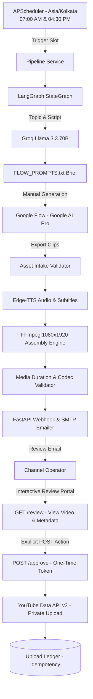

# AI Engineering YouTube Shorts Automation System

An automated, human-in-the-loop production pipeline designed to generate, assemble, review, and publish two high-retention English YouTube Shorts per day for an AI Engineering channel.

## 🚀 Key Features

- **Daily Dual Scheduling**: Runs every day at **07:00 AM IST** (Morning) and **04:30 PM IST** (Evening) using `APScheduler` in `Asia/Kolkata` timezone.
- **AI Orchestration with LangGraph & Groq**: Powered by `llama-3.3-70b-versatile` via `langchain-groq` and LangGraph `StateGraph`, generating hook-driven scripts, scene breakdowns (30–45s), visual prompts, and SEO metadata.
- **Anti-Duplication Protection**: Persistent `topic_history.json` prevents duplicate topics across runs.
- **Google Flow Handoff**: Generates a dedicated `FLOW_PROMPTS.txt` with scene-by-scene prompts formatted for 9:16 vertical video creation in Google Flow under Google AI Pro. Strictly manual export/import boundary (no brittle browser scraping or private APIs).
- **Automated FFmpeg Assembly**:
  - Concatenates scene clips in strict numerical order (`scene_01.mp4`, `scene_02.mp4`, etc.).
  - Normalizes to **1080x1920 (9:16 portrait)**, 30 FPS, H.264 video (`yuv420p`), AAC audio.
  - Automatically generates synchronized neural voiceover and subtitles via `Edge-TTS` (with support for manual recorded voiceover overrides).
  - Validates output dimensions, duration bounds (30–45s), and computes SHA-256 integrity checksum.
- **Secure Email Approval Gate**:
  - Delivers an HTML review notification via SMTP with video metadata and breakdown.
  - **Single-use, cryptographically secure 32-byte tokens** stored as SHA-256 hashes with 24-hour expiration.
  - Anti-scanner protection: GET requests only open the web review portal. Approval requires an explicit interactive POST action, preventing email scanners (e.g. Outlook Safelinks, Gmail prefetchers) from auto-uploading.
- **Private YouTube Publishing & Upload Idempotency**:
  - Authorized via YouTube Data API v3 OAuth.
  - All videos are published strictly as **Private** initially.
  - Includes synthetic media disclosure flags and full SEO tags/descriptions.
  - Guarded by `upload_ledger.json`—re-approval or retry requests safely return the existing YouTube video ID without creating duplicate uploads.

---

## 🛠️ Architecture Overview



---

## 📋 Prerequisites

1. **Python 3.11+** (Windows, Linux, or macOS).
2. **FFmpeg & FFprobe**:
   - Installed and available on system `PATH` (on Windows: `winget install Gyan.FFmpeg`).
3. **Groq API Key**:
   - Get your free/pay-as-you-go key from [console.groq.com](https://console.groq.com).
4. **Google AI Pro (Google Flow)**:
   - For generating scene video clips.
5. **Google Cloud Project with YouTube Data API v3**:
   - OAuth 2.0 Desktop Application credentials saved as `client_secret.json`.
6. **SMTP Email Account**:
   - For delivery of approval notifications (e.g. Gmail with an App Password).

---

## ⚙️ Installation & Setup

1. **Activate the virtual environment**:
   ```powershell
   .venv\Scripts\Activate.ps1
   ```

2. **Configure Environment Variables**:
   Copy `.env.example` to `.env` and fill in your credentials:
   ```powershell
   Copy-Item .env.example .env
   ```
   Key configuration variables in `.env`:
   ```ini
   GROQ_API_KEY=gsk_your_groq_api_key_here
   GROQ_MODEL=llama-3.3-70b-versatile
   APPROVAL_RECIPIENT_EMAIL=your_email@gmail.com
   SMTP_USERNAME=your_email@gmail.com
   SMTP_PASSWORD=your_gmail_app_password
   TIMEZONE=Asia/Kolkata
   ```

3. **Verify Installation**:
   Run the test suite to ensure all dependencies and FFmpeg are functioning:
   ```powershell
   python -m pytest -v
   ```

---

## 💻 CLI Usage Guide

The unified CLI (`cli.py`) controls all pipeline stages:

### 1. Generate a Content Package & Flow Brief
Generate a topic, script, metadata, and Flow prompts for a specific slot:
```powershell
python cli.py generate --slot morning
# Or evening:
python cli.py generate --slot evening
```
*Outputs: `data/packages/<run_id>.json` and `data/flow_exports/<run_id>/FLOW_PROMPTS.txt`.*

### 2. Assemble Exported Google Flow Clips
After exporting `scene_01.mp4`..`scene_0N.mp4` from Google Flow into `data/flow_exports/<run_id>/`:
```powershell
python cli.py assemble --run-id <run_id>
```
*Standardizes clips to 1080x1920 9:16 portrait, synthesizes voiceover and subtitles, and verifies duration (30-45s).*

### 3. Send Approval Request
Generate an expiring single-use token and email the review invitation:
```powershell
python cli.py notify --run-id <run_id>
```

### 4. Run the Approval Web Service
Start the FastAPI review server to preview and approve videos:
```powershell
python cli.py serve
```
*Visit `http://127.0.0.1:8000/review/<run_id>?token=<token>` to review the video and authorize upload.*

### 5. Start Daily Scheduler Daemon
Run the APScheduler background runner that automatically triggers morning (07:00 IST) and evening (16:30 IST) pipelines:
```powershell
python cli.py schedule
```

### 6. Inspect System Status
Check recent production runs, topic history, and upload records:
```powershell
python cli.py status
```

---

## 🐳 Running with Docker & Docker Compose

The system is fully containerized with FFmpeg, Python 3.11, and `Asia/Kolkata` timezone configured.

### 1. Start All Background Services
Launch both the **FastAPI Approval Portal** and **APScheduler Service** in detached mode:
```powershell
docker compose up --build -d
```
- **Approval Portal**: Accessible at `http://localhost:8000`
- **Scheduler**: Automatically runs daily production at **07:00 AM IST** and **04:30 PM IST**.
- **Data Persistence**: `./data` and `./logs` on your host are bound directly to `/app/data` and `/app/logs`. Clips you place in `./data/flow_exports/` on your host are instantly available to the container.

### 2. View Live Logs
```powershell
docker compose logs -f
```

### 3. Run Pipeline CLI Commands via Docker
You can execute any CLI operation directly inside the containerized environment:

- **Generate Content Package**:
  ```powershell
  docker compose run --rm approval-service generate --slot morning
  ```

- **Assemble Google Flow Clips with Containerized FFmpeg**:
  ```powershell
  docker compose run --rm approval-service assemble --run-id <run_id>
  ```

- **Send Review Email**:
  ```powershell
  docker compose run --rm approval-service notify --run-id <run_id>
  ```

- **Check Pipeline Status**:
  ```powershell
  docker compose run --rm approval-service status
  ```

### 4. Stop Services
```powershell
docker compose down
```

---

## ☁️ Deploying on Render

This repository includes a `render.yaml` Blueprint and a `$PORT`-aware `Dockerfile` ready for Render deployment:

1. **YouTube OAuth (One-Time Local Authorization)**:
   Run `python cli.py youtube-auth` locally with `client_secret.json` in the project root to generate `token.json`.
2. **Create Web Service on Render**:
   Push to GitHub and create a **Web Service** (or **New > Blueprint** using `render.yaml`) on Render.
3. **Configure Environment Variables on Render**:
   Set `GROQ_API_KEY`, `APPROVAL_SECRET_KEY`, `SMTP_USERNAME`, `SMTP_PASSWORD`, `SENDER_EMAIL`, `APPROVAL_RECIPIENT_EMAIL`, `ENABLE_EMBEDDED_SCHEDULER=true`, and either set `YOUTUBE_CLIENT_SECRET_JSON` + `YOUTUBE_TOKEN_JSON` or upload `client_secret.json` & `token.json` as Render Secret Files.
4. **Upload Google Flow Clips via Web UI**:
   Open your Render dashboard URL, click **Google Flow Prompts Brief**, generate clips in Google Flow, click **Upload Clips** on the run card to upload `scene_01.mp4 .. scene_0N.mp4`, then click **Assemble Video (FFmpeg)** and **Open Review Portal**.

---

## 🔒 Security & Safe Publishing

1. **Zero Credential Exposure**: API keys, SMTP passwords, and OAuth tokens are loaded strictly via `.env` and `pydantic-settings`. All logs automatically redact secret patterns (`gsk_...`, bearer tokens, passwords).
2. **Single-Use, Expiring Tokens**: Approval tokens are generated using `secrets.token_urlsafe(32)`, stored strictly as SHA-256 hashes, and invalidated immediately upon first use (`consumed_at_utc`).
3. **Anti-Scanner Protection**: Enterprise spam and security scanners pre-fetch GET links. In this system, visiting the link renders the preview; upload requires an explicit interactive POST action.
4. **Duplicate Upload Protection**: Every upload is recorded in `data/upload_ledger.json` with the video's SHA-256 hash. Replays or accidental clicks will never upload duplicate videos.
5. **Private by Default**: All videos are uploaded with `privacyStatus = "private"`. Public publishing is controlled manually from YouTube Studio after review.
